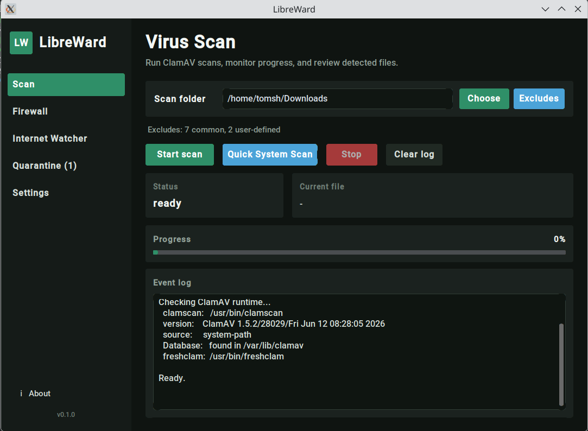

# LibreWard

LibreWard is a security and privacy desktop application for Linux and Windows,
built with Python and PySide6 / Qt. Antivirus scanning through ClamAV is
available today. Firewall, internet monitoring and DNS/privacy features are
planned; their placeholder pages do not provide protection yet.



## Features

- Folder and Quick system scans with common and custom exclusions.
- Parallel checks of up to four files with `clamd`, with fallback to `clamscan`
  when daemon setup is unavailable.
- Progress percentage, single-line current-file paths with full-path tooltips,
  a sidebar activity indicator and an automatic scan report dialog.
- Separate warnings, scan failures and detections; confirmed quarantine,
  restore and permanent deletion. Files are never automatically deleted.
- Guided engine/database/daemon setup, database updates and Windows portable
  runtime installation and repair.
- Dark, light and system themes; remembered window size, position and maximized state.

## Run from source

Clone or download the project and run these commands from its directory.
Python 3.10 or newer with virtual-environment support is required. Dependencies are
listed in [requirements.txt](requirements.txt).

### Linux

```bash
python3 -m venv venv
source venv/bin/activate
python -m pip install --upgrade pip
python -m pip install -r requirements.txt
python main.py
```

### Windows (PowerShell)

```powershell
py -m venv venv
.\venv\Scripts\python.exe -m pip install --upgrade pip
.\venv\Scripts\python.exe -m pip install -r requirements.txt
.\venv\Scripts\python.exe main.py
```

ClamAV is a separate runtime; installing Python dependencies does not install
the engine or virus database. Open **Settings → Enable antivirus protection /
setup** to check components and follow the next setup step. Linux uses
distribution packages. Windows offers an official portable runtime download
with user consent. Scanning requires a working engine and database; `clamd`
is optional.

## Documentation

- [Documentation index](docs/README.md)
- [Setup, updates and data locations](docs/setup.md)
- [Scanning, exclusions and results](docs/scanning.md)
- [Development, tests and release checks](docs/development.md)

## Licensing

LibreWard is licensed under **GPL-2.0-or-later**. See [LICENSE](LICENSE).
It executes external ClamAV tools including `clamscan`, `clamd` and `freshclam`.
ClamAV is developed by the ClamAV project/Cisco Talos and licensed separately
under GNU GPL version 2. Archives bundling ClamAV must retain its license and
copyright notices alongside LibreWard's license.

PySide6 / Qt uses the open-source **LGPLv3** option; it is not MIT-licensed.
Distributions must satisfy the applicable Qt requirements, including library
replacement where required. See [Qt licensing](https://doc.qt.io/qt-6/licensing.html)
and [Qt for Python licensing](https://doc.qt.io/qtforpython-6/licenses.html).
